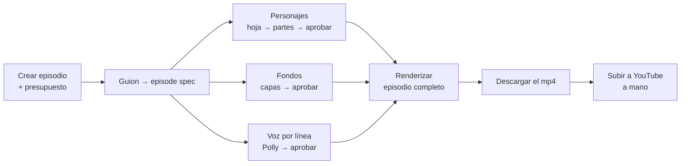

# Manual de usuario

Esta guía documenta el camino real, tal como existe hoy en la app, para construir
un episodio completo: desde el guion hasta el video terminado, descargado y listo
para subir a YouTube.

!!! info "Qué cubre y qué no"
    Cubre todo lo que ya está construido y probado en la app (dashboard, generación
    de personajes/fondos/voz, presupuesto, render del episodio completo, descarga).
    **No cubre la subida a YouTube en sí** — hoy es un paso manual en YouTube Studio,
    documentado en el [último capítulo](08-descargar-subir-youtube.md).

## El camino, de un vistazo

Los pasos C, D y E (personajes, fondos, voz) se pueden hacer en cualquier orden,
y los personajes/fondos se pueden reutilizar entre episodios — no hay que
rehacerlos cada vez.

## Antes de empezar: la pausa de costos

Por decisión explícita tuya (ver `docs/PROGRESS.md` del repo), **todos los jobs
corren simulados por defecto** (`--dry-run`, cero llamadas a AWS) salvo que pidas
explícitamente lo contrario. Esta guía asume que en algún punto vas a querer
generar cosas de verdad — cuando llegue ese momento, cada capítulo te muestra
exactamente dónde está el checkbox "Simular" que hay que destildar, y qué cuesta
hacerlo.

## Qué necesitás tener a mano

- Las credenciales de tu usuario en la app (email + contraseña — si no las tenés,
  alguien con acceso a `apps/web/scripts/crear_tenant.py` te puede dar de alta).
- Si vas a generar cosas reales (no simuladas): que la cuenta de AWS tenga crédito
  y que el perfil de pago de Marketplace esté en USD (ver nota en el capítulo de
  presupuesto si esto da error la primera vez).
